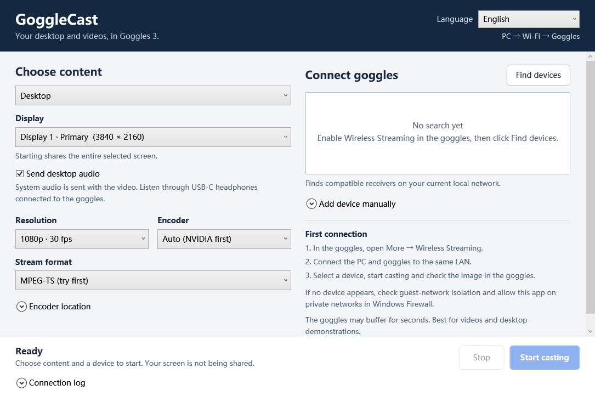

# GoggleCast · 观幕

**Cast a Windows desktop or local video wirelessly to DJI Goggles 3.**

[简体中文](README.md) · [Download](https://github.com/beaver-fpv/GoggleCast/releases/latest) · [Usage guide (Chinese)](docs/USAGE.zh-CN.md) · [Troubleshooting (Chinese)](docs/TROUBLESHOOTING.zh-CN.md)

GoggleCast is a Windows application, available as an installer or a portable ZIP, that sends desktop video and system audio, or a local video file, to the goggles using DLNA / UPnP on your LAN. It requires no phone, tablet or virtual display driver. It is intended for watching videos and presenting a desktop.



```text
Windows desktop + system audio / local video + audio track
                           ↓
                    GoggleCast → LAN
                           ↓
                Goggles 3 Wireless Streaming
                           ↓
               Goggles display + goggles headphones
```

## Features

| Feature | Details |
| --- | --- |
| Desktop sharing | Choose a monitor and share its entire contents at 1080p30 or 720p30. |
| Desktop system audio | Enabled by default. WASAPI loopback captures the default Windows playback device, using a common time origin with desktop video. It does not record the microphone. |
| Local video | Compatible H.264 / AAC transcoding by default, with aspect ratio preserved and the first readable audio track retained. |
| Optional direct MP4 playback | Send a compatible MP4 / M4V without FFmpeg. Playback depends on the receiver's codec, dimension and file support. |
| Encoding | Automatically tests NVIDIA NVENC and falls back to CPU; software encoding can also be selected explicitly. |
| Stream formats | MPEG-TS by default, with fragmented MP4 as an alternative. |
| Receiver discovery | Search the LAN or enter a receiver IP / HTTP device-description URL. |
| Diagnostics | Moving test pattern and tone, connection log and transport status. |
| Languages | Simplified Chinese, Traditional Chinese, English, Japanese, Korean, Spanish, French and German, plus system-language selection. |

## Requirements

- **Windows 10 / 11 x64** and .NET Framework 4.8.
- **DJI Goggles 3** with More → Wireless Streaming available. Other DLNA receivers have not been compatibility-tested.
- The PC and goggles on the same **IPv4 LAN**. The goggles may connect to a Windows mobile hotspot hosted by the PC. An Ethernet-connected PC on the same router also works as a network arrangement.
- **FFmpeg** for desktop sharing, test patterns and video transcoding. The recommended offline installer includes it; portable users supply it separately.
- USB-C digital DAC headphones, or a compatible adapter, connected to the goggles for audio. Goggles 3 has no built-in speaker.

## Download and install

Choose an asset from [the latest release](https://github.com/beaver-fpv/GoggleCast/releases/latest):

| Download | Intended use | Encoder and connectivity |
| --- | --- | --- |
| **`GoggleCast-0.1.0-Setup.exe` — recommended** | Install the app with shortcuts and an uninstaller. | A complete offline installer including a pinned FFmpeg build. Setup makes no network requests; the app automatically finds the encoder in `runtime/`. |
| Portable ZIP | Manage the application and an existing FFmpeg yourself. | Extract the complete archive and supply FFmpeg separately. |

**Installer:** Download Setup, open it, choose an installation folder and click Install. Then launch the app using its shortcut. The package includes both the app and FFmpeg, so you can disconnect from the internet before installing; Setup does not download dependencies. Installation is per-user, needs no administrator rights and lets you choose another folder. FFmpeg is found automatically, with no manual encoder-path configuration. Setup is available in Chinese and English; the application itself supports eight languages.

The system must already have **.NET Framework 4.8**. If an older Windows installation lacks it, prepare and install the appropriate offline .NET Framework runtime first. Setup does not include the entire Windows runtime environment or GPU drivers.

**Portable:** Extract to a writable folder, keeping `GoggleCast.exe` and `MainWindow.xaml` together. Run the EXE and choose your own `ffmpeg.exe` in the encoder-path section, or configure it as described below.

Releases are not Windows code-signed, so Windows may show an unknown-publisher or SmartScreen prompt. If a direct asset link fails, choose the file from the [Releases page](https://github.com/beaver-fpv/GoggleCast/releases).

## Start casting

1. Connect the PC and goggles to the same network. In the goggles, open **More → Wireless Streaming** and keep the goggles awake on that page.
2. Launch GoggleCast and select English in the top-right language selector. Choose a desktop monitor or a local video; start with 1080p30, automatic encoding and MPEG-TS.
3. Search for receivers, select the goggles and start casting. Wait for buffering, then check the actual image and sound in the goggles.
4. Click Stop when finished.

After the encoder is installed, casting only needs LAN connectivity between the PC and goggles, not internet access.

Search again after reconnecting Wi-Fi or reopening Wireless Streaming: the receiver's IP address and service port can change. If Windows Firewall asks, allow the app only on a trusted private network. The application does not change firewall, hotspot or network settings for you.

## Audio synchronization and latency

**Listen through headphones connected to the goggles.** Desktop video and WASAPI system audio use a shared time origin. Local videos retain their existing audio/video timeline. Both tracks are sent in the same media stream for timestamp-based playback by the receiver.

Synchronized audio does not mean zero end-to-end latency. Encoding, network transmission and receiver buffering still delay the picture and sound together; the receiver may buffer several seconds. This makes the app suitable for videos and desktop presentations, rather than a low-latency gaming display.

Audio playing directly on the PC is neither delayed nor muted automatically. PC headphones can therefore play sound before the corresponding image appears in the goggles. This release has no PC-headphone delay compensation. Stop and restart casting after changing the default Windows playback device.

## Validation and limits

On **2026-10-18**, an actual Goggles 3 was used to verify:

- A moving test pattern displayed correctly.
- A 1080p30 desktop displayed correctly, with system audio through goggles headphones; the wearer reported normal subjective audio/video synchronization.
- A transcoded local video played correctly, with the wearer reporting normal subjective audio/video synchronization through goggles headphones.

The desktop/audio test used NVENC, MPEG-TS and 48 kHz stereo loopback audio. Local checks also covered protocol handling, HTTP byte ranges, continuous encoding, media timestamps, localization and stop/cleanup behavior.

**Precise end-to-end latency, millisecond-level A/V error and long-term drift were not measured.** These results are not a zero-latency claim or a guarantee for other PCs, firmware, networks or audio outputs. An accepted request, transferred bytes or a reported `PLAYING` state is not proof that the goggles are displaying the expected picture.

## FFmpeg and installation maintenance

The offline Setup includes a pinned **FFmpeg 9.0.2 Essentials** build. Its upstream archive is verified against an expected SHA-256 while building the release. Setup extracts the packaged runtime into `runtime/` without contacting the upstream provider.

Portable and source-build users can obtain a Windows build from the [FFmpeg download page](https://ffmpeg.org/download.html), or use a legitimate existing installation. It must provide `gdigrab`, `libx264` and AAC encoding. NVIDIA hardware encoding additionally requires `h264_nvenc`, a compatible GPU and drivers.

Choose `ffmpeg.exe` in the encoder-path section, place it at `runtime/ffmpeg.exe` or `ffmpeg.exe` beside the app, set `GOGGLECAST_FFMPEG`, or add it to `PATH`. Select the path again if you move the executable.

To upgrade, close the app and run the new installer. Setup reuses the previous location, updates the app and packaged runtime files, and preserves `settings.xml` and `logs/`. Use Windows Installed apps / Apps & features to uninstall an installed copy; generated settings and logs are retained. Stop and remove the folder to remove a portable copy. See the [maintenance guide (Chinese)](docs/USAGE.zh-CN.md#安装升级与卸载) for details and encoder repair.

The included FFmpeg build uses GPLv3 and runs as a separate process. GoggleCast's MIT source license does not replace it. The installed runtime retains its license, README and provenance information; see [THIRD-PARTY-NOTICES.txt](THIRD-PARTY-NOTICES.txt) for corresponding-source and build-provenance information. If you supply another FFmpeg build, check its own license. See also [FFmpeg legal information](https://ffmpeg.org/legal.html).

## Build from source

The app uses native WPF, .NET Framework and C# 5. The build script calls the Windows .NET Framework C# compiler directly; it does not require the .NET SDK, Visual Studio or NuGet packages.

On Windows x64 with .NET Framework 4.8:

```powershell
git clone https://github.com/beaver-fpv/GoggleCast.git
cd GoggleCast
powershell -NoProfile -ExecutionPolicy Bypass -File .\build.ps1
```

The output is in `dist/`. Run `dist/GoggleCast.exe` with `MainWindow.xaml` beside it. A separately installed FFmpeg is still needed for desktop capture and transcoding.

### Build the installer

Install **Inno Setup 6.7.3 or newer** on Windows, ensure Windows `tar.exe` is available, and obtain the pinned `ffmpeg-9.0.2-essentials_build.7z` described in `installer/runtime.json`. With that archive in the repository root, run:

```powershell
powershell -NoProfile -ExecutionPolicy Bypass -File .\build-installer.ps1 -RuntimeArchive ".\ffmpeg-9.0.2-essentials_build.7z"
```

This verifies, extracts and packages the pinned dependency into a complete offline Setup executable. The script itself does not download files: `-RuntimeArchive` must point to an existing local archive. You can prepare that archive on an internet-connected build machine before invoking the script; users running the resulting Setup do not download dependencies.

`installer/runtime.json` records the pinned version, upstream URLs and expected SHA-256. Check these together when changing dependencies, and retain the matching license and corresponding-source provenance when distributing binaries. A changed upstream file must not be treated as the same dependency.

Other options include `-Version`, `-AppDirectory`, `-Output`, `-Iscc` and `-SkipBuild`. By default, application files come from `dist/` and installers are written to `artifacts/`. If Inno Setup is not detected, pass the full path of `ISCC.exe` through `-Iscc`.

```text
src/          WPF UI, DLNA, HTTP, media capture and localization
tests/        Protocol and interaction checks
docs/         Usage and troubleshooting guides
build.ps1     .NET Framework compilation and portable output
build-installer.ps1  Complete offline installer build entry point
```

Protocol and UI flow checks can be run in Windows PowerShell 5.1:

```powershell
powershell -NoProfile -ExecutionPolicy Bypass -File .\tests\CheckProtocol.ps1
powershell -NoProfile -ExecutionPolicy Bypass -File .\tests\CheckUiFlow.ps1
```

The UI check creates a local mock receiver and runs FFmpeg, so it needs a working FFmpeg installation and local networking. It does not replace real-device testing. Do not commit generated test output, logs or personal media.

## Local data and issue reports

There is no account or cloud service. While casting, the app serves the selected media over temporary HTTP on the chosen LAN interface. Stopping or closing it shuts down that session's server and encoder. It does not offer directory browsing. The temporary media URL is not account authentication; use a trusted LAN.

The language preference and selected FFmpeg path are stored in `settings.xml` beside the application, and logs are written to `logs/`. The UI and common errors are localized; original Windows, device and FFmpeg diagnostics retain their original text.

When opening an [issue](https://github.com/beaver-fpv/GoggleCast/issues), include the app version, Windows and goggles firmware versions, network arrangement, source/encoding settings and reproduction steps. Redact file paths, device names and network addresses from logs before sharing. Personal videos, full desktop recordings and network passwords are not needed.

## Project notice

This is an independent project, not an official DJI product and not endorsed by DJI. It sends **PC → goggles**; drone video or USB goggles-to-PC capture is a different workflow.

The source uses the [MIT license](LICENSE). See [THIRD-PARTY-NOTICES.txt](THIRD-PARTY-NOTICES.txt) for dependency notices.
