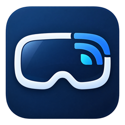
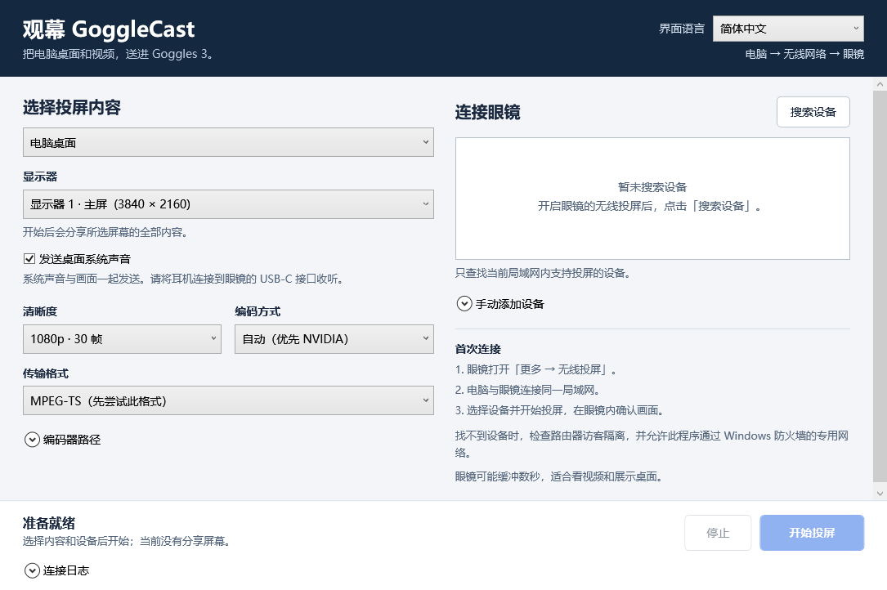

# 观幕 GoggleCast



**把 Windows 电脑桌面和本地视频，无线投到支持 DLNA 的 DJI 眼镜。**

[English](README.en.md) · [下载最新版](https://github.com/beaver-fpv/GoggleCast/releases/latest) · [详细使用说明](docs/USAGE.zh-CN.md) · [常见问题](docs/TROUBLESHOOTING.zh-CN.md)

GoggleCast 是一个 Windows 桌面投屏程序，提供安装版和便携版。电脑和眼镜连接同一局域网后，通过 DLNA / UPnP 发送桌面画面或视频文件，无需手机、平板或虚拟显示驱动。适合看视频、演示和展示电脑桌面。

**兼容情况：Goggles 3 已实机验证；Goggles 2 官方支持 DLNA，可尝试使用，本项目尚未实机验证；Goggles N3 当前不列入兼容名单。** 详见下方兼容表及[型号依据与验证方法](docs/COMPATIBILITY.md)。



```text
电脑桌面 + 系统声音 / 本地视频 + 音轨
                  ↓
          GoggleCast → 局域网
                  ↓
       DJI 眼镜「无线投屏」
                  ↓
           眼镜画面 + 眼镜耳机
```

## 能做什么

| 功能 | 说明 |
| --- | --- |
| 桌面投屏 | 选择一台显示器，发送该屏幕的全部内容；支持 1080p / 30 帧和 720p / 30 帧。 |
| 桌面系统声音 | 默认开启。通过 WASAPI 采集 Windows 默认播放设备的声音，和桌面画面使用共同时间起点；不采集麦克风。 |
| 本地视频 | 默认转为兼容的 H.264 / AAC，等比缩放并保留第一条可读取的音轨。 |
| MP4 原画直传 | 可手动开启，兼容文件无需 FFmpeg；能否播放取决于眼镜对文件编码、尺寸等的支持。 |
| 编码选择 | 自动探测 NVIDIA NVENC，不可用时回退至 CPU；也可手动选择软件编码。 |
| 传输格式 | 默认 MPEG-TS，另提供分片 MP4 作为兼容备选。 |
| 设备连接 | 搜索局域网接收端，或输入眼镜 IP / 设备描述文件 HTTP 地址。 |
| 连接排查 | 动态测试图、提示音、连接日志和收发状态。 |
| 多语言 | 简体中文、繁体中文、English、日本語、한국어、Español、Français、Deutsch；可跟随系统。 |

## 眼镜兼容性

| 型号 | 当前状态 | 说明 |
| --- | --- | --- |
| **DJI Goggles 3** | **已实机验证** | 测试图、1080p / 30 帧桌面、兼容转码视频及眼镜耳机声画同步已确认。 |
| **DJI Goggles 2** | **协议兼容，待实机验证** | [DJI 官方](https://www.dji.com/support/product/goggles-2)明确支持 DLNA 无线投屏；本软件使用相同协议，可尝试连接，但尚未用本项目验证桌面、视频及声音。 |
| **DJI Goggles N3** | **当前不列入兼容名单** | 未找到官方支持 DLNA 投屏接收的依据；存储卡播放和 USB 分享飞行画面不能证明它可接收电脑投屏。 |
| 其他 DLNA 接收端 | 实验性，未验证 | 需要在局域网公开 UPnP MediaRenderer / AVTransport 服务，并支持本软件发送的音视频格式；仅支持 DLNA 文件共享不够。 |

核查日期：**2026-10-18**。上述“协议兼容”是根据公开资料和程序使用的协议作出的判断，不代表已完成该型号的实机测试，也不是 DJI 对本软件的认证。Goggles 2 与 DJI FPV Goggles V2 是不同型号。官方来源、连接方法和实测反馈要求见[兼容说明](docs/COMPATIBILITY.md)。

## 运行要求

- Windows 10 / 11 **x64**，安装 .NET Framework 4.8。
- 能开启 DLNA 无线投屏接收的眼镜。Goggles 3 已实测；Goggles 2 可按上表尝试，其结果仍需实机确认。
- 电脑和眼镜处于同一 **IPv4 局域网**。眼镜连接电脑的 Windows 移动热点也可以；使用路由器时，电脑可以接网线。
- 桌面投屏、测试画面和视频转码需要 **FFmpeg**。推荐离线安装包已包含编码器，便携版需自行准备。
- 如需听声音，Goggles 3 使用连接眼镜 USB-C 接口的数字 DAC 耳机或兼容转接头；Goggles 2 使用眼镜的 3.5 mm 耳机接口。音频硬件说明依据 DJI 文档，Goggles 2 的本软件声音播放仍待实测。

## 下载安装

在 [最新版 Releases](https://github.com/beaver-fpv/GoggleCast/releases/latest) 中选择需要的文件：

| 下载类型 | 适合谁 | 编码器与联网要求 |
| --- | --- | --- |
| **`GoggleCast-0.1.0-Setup.exe`（推荐）** | 希望安装后直接使用，并创建快捷方式的用户。 | 完整离线安装包，包含固定版 FFmpeg，安装时不请求网络；安装后自动找到 `runtime/` 中的编码器。 |
| 便携 ZIP | 希望自行管理文件和已有 FFmpeg 的用户。 | 完整解压后使用；不包含 FFmpeg，需自行选择或放置编码器。 |

**安装版：** 下载 Setup 后，打开它，选择安装位置，点击安装，再通过快捷方式启动。安装包已包含程序和 FFmpeg，安装过程不下载依赖，可断开互联网安装。按当前用户安装，无需管理员权限，可在安装界面改选其他目录；程序自动找到编码器，无需手工配置。安装器提供中文、英文，软件界面提供八种语言。

离线安装包仍要求系统已具备 **.NET Framework 4.8**。如果旧版 Windows 尚未具备该运行环境，请事先安装相应的 .NET Framework 离线运行库；Setup 不包含整个 Windows 运行环境或显卡驱动。

**便携版：** 完整解压到可写文件夹，保留 `GoggleCast.exe` 和 `MainWindow.xaml` 在同一目录。双击 EXE 后，展开「编码器路径」选择自备的 `ffmpeg.exe`，或按下文方式放置编码器。

发行版尚未进行 Windows 代码签名，遇到系统提示时可查看 [启动问题](docs/TROUBLESHOOTING.zh-CN.md#windows-提示未知发布者或-smartscreen)。如果直接下载链接失效，请回到 [Releases 页面](https://github.com/beaver-fpv/GoggleCast/releases) 选择附件。

## 开始投屏

1. 连接电脑和眼镜的局域网。在眼镜中打开无线投屏等待页面，并保持眼镜唤醒。Goggles 3 的路径是「更多 → 无线投屏」；Goggles 2 请按其手册开启无线投屏。
2. 启动 GoggleCast，选择「电脑桌面」和显示器，或选择「本地视频」及文件。首次使用可保留默认的 1080p、自动编码和 MPEG-TS。
3. 点击「搜索设备」，选中眼镜，再点击「开始投屏」。等待眼镜完成缓冲，在眼镜内确认画面和声音。
4. 结束时点击「停止」。

编码器安装完成后，正常投屏只需电脑和眼镜在局域网内互通，不需要互联网。

首次找不到设备时，请查看 [连接排查](docs/TROUBLESHOOTING.zh-CN.md#找不到眼镜)。眼镜重新连接网络或重新打开无线投屏后，IP 和服务端口可能改变，**请重新搜索设备**。

如果 Windows 弹出防火墙提示，请仅在你信任的专用网络允许本程序。GoggleCast 不会自动修改防火墙、热点或网络设置。

## 声音同步与延迟

**请从连接到眼镜的耳机收听声音。** 桌面画面和系统声音使用共同时间起点，本地视频保留原有音视频时间线；音视频放在同一条媒体流中，交由眼镜按时间戳播放。

这能让声音与眼镜中的画面对齐，但电脑到眼镜仍存在编码、网络和接收端缓冲。接收端可能缓冲数秒，因此本工具适合视频观看和桌面展示，不能据此当作低延迟游戏显示器。

电脑本机声音不会被自动延迟或静音。如果从电脑耳机收听，可能先听到电脑声音，再看到眼镜画面；当前版本没有电脑耳机延迟补偿。投屏期间更换 Windows 默认播放设备后，请停止并重新开始投屏。

## 已验证的范围

2026-10-18，在一台实际 Goggles 3 上完成了以下验证：

- 动态测试图正常显示。
- 1080p / 30 帧桌面正常显示，桌面系统声音通过眼镜耳机播放，体验者确认主观声画同步正常。
- 本地视频经兼容转码后正常播放，体验者确认眼镜耳机的声音与画面同步正常。

桌面声音实测使用 NVENC、MPEG-TS 和 48 kHz 双声道系统声音。另完成了本地协议、HTTP 范围请求、持续编码、音视频时间戳、多语言和停止清理检查。

**没有测量精确端到端延迟、毫秒级声画误差或长时间漂移。** 主观同步正常不代表零延迟，其他电脑、固件、网络和音频输出路径仍需实测。程序显示请求已接受、正在发送数据或设备报告 `PLAYING`，也不能代替眼镜内的实际确认。

## FFmpeg 与安装维护

推荐离线 Setup 包含固定的 **FFmpeg 8.1.2 (BtbN)** 构建。构建发行包时校验运行时归档的 SHA-256，安装时直接从 Setup 释放到程序的 `runtime/`，不向上游请求下载。精确版本、二进制校验值及两个配套源码附件见 [FFmpeg 对应源码与构建来源](docs/FFMPEG-SOURCES.md)。

便携版或源码运行用户可从 [FFmpeg 官方下载页](https://ffmpeg.org/download.html) 获取 Windows 构建，或使用已有的合法安装。所选构建需提供 `gdigrab`、`libx264` 和 AAC 编码器；NVIDIA 硬件编码还需要 `h264_nvenc`、兼容显卡和驱动。

在程序中展开「编码器路径」选择 `ffmpeg.exe`，或将它放在程序旁的 `runtime/ffmpeg.exe` / `ffmpeg.exe`，设置 `GOGGLECAST_FFMPEG` 环境变量，或加入 `PATH`。移动 FFmpeg 后，请重新选择有效路径。

升级时先关闭 GoggleCast，再运行新安装器；安装器沿用原安装位置，更新程序及随包运行文件，保留 `settings.xml` 和 `logs/`。安装版可通过 Windows「已安装的应用／应用和功能」卸载，卸载保留自行生成的设置和日志。便携版停止运行后移除其文件夹即可。具体维护和编码器修复方法见 [安装维护说明](docs/USAGE.zh-CN.md#安装升级与卸载)。

随包 FFmpeg 使用 GPLv3，作为独立进程运行；其许可证不受 GoggleCast 源码的 MIT 许可证替代。安装目录保留 FFmpeg 许可证、说明及来源资料；对应源码与构建来源说明见 [第三方说明](THIRD-PARTY-NOTICES.txt)。自备其他 FFmpeg 构建时，还应核对该构建自己的许可证。参见 [FFmpeg 法律说明](https://ffmpeg.org/legal.html)。

## 详细文档

- [眼镜兼容说明：Goggles 3、Goggles 2、N3 与实测反馈](docs/COMPATIBILITY.md)
- [使用说明：联网、桌面、视频、声音和各项设置](docs/USAGE.zh-CN.md)
- [常见问题：发现设备、无画面、无声音、卡顿和日志](docs/TROUBLESHOOTING.zh-CN.md)
- [英文主页 / English README](README.en.md)

## 从源码构建

这是一个原生 WPF / .NET Framework 程序，源代码使用 C# 5。构建脚本直接调用 Windows 的 .NET Framework C# 编译器；无需安装 .NET SDK、Visual Studio 或 NuGet 包。

在装有 .NET Framework 4.8 的 Windows x64 电脑中，下载源码或克隆仓库，然后运行：

```powershell
git clone https://github.com/beaver-fpv/GoggleCast.git
cd GoggleCast
powershell -NoProfile -ExecutionPolicy Bypass -File .\build.ps1
```

输出位于 `dist/`。运行 `dist/GoggleCast.exe`，并保留旁边的 `MainWindow.xaml`。使用源码构建也需自行准备 FFmpeg，才能采集桌面或转码视频。

### 构建安装器

在 Windows 上另外安装 **Inno Setup 6.7.3 或更新版本**，准备 Windows `tar.exe`，并预先取得 `installer/runtime.json` 指定的 `GoggleCast-FFmpeg-8.1.2-runtime.zip`。假设压缩包位于仓库根目录，运行：

```powershell
powershell -NoProfile -ExecutionPolicy Bypass -File .\build-installer.ps1 -RuntimeArchive ".\GoggleCast-FFmpeg-8.1.2-runtime.zip"
```

该入口生成完整离线 Setup，并在构建阶段校验、解包和打包固定依赖。脚本本身不会下载文件，`-RuntimeArchive` 必须指向准备好的本地压缩包；可以在联网构建机上先下载，再传入构建入口。用户运行生成的 Setup 时不下载任何依赖。

`installer/runtime.json` 记录固定版本、上游地址与预期 SHA-256；更改依赖时应同步核对这些信息。随二进制发布应保留对应 FFmpeg 许可证和源码来源资料，不能把任意更新后的上游文件当作同一依赖。

其他常用参数为 `-Version`、`-AppDirectory`、`-Output`、`-Iscc` 和 `-SkipBuild`。默认从 `dist/` 取程序，输出到 `artifacts/`；未能自动找到 Inno 编译器时，用 `-Iscc` 指定 `ISCC.exe` 完整路径。

主要目录：

```text
src/          WPF 界面、DLNA、HTTP、音视频与多语言代码
tests/        协议及交互验证脚本
docs/         使用和排查文档
build.ps1     .NET Framework 编译与便携文件生成
build-installer.ps1  完整离线安装器构建入口
```

可在 Windows PowerShell 5.1 中运行协议与界面流程检查：

```powershell
powershell -NoProfile -ExecutionPolicy Bypass -File .\tests\CheckProtocol.ps1
powershell -NoProfile -ExecutionPolicy Bypass -File .\tests\CheckUiFlow.ps1
```

界面流程检查会在本机创建测试接收端并运行 FFmpeg，需要可用的 FFmpeg 和允许本地通信的运行环境；它不能代替真实眼镜验证。请不要把测试输出、日志或自己的媒体文件提交到仓库。

## 本地数据与反馈

GoggleCast 不需要账号或云服务。开始投屏后，会在选定的局域网网卡上为本次内容提供临时 HTTP 媒体服务；停止或关闭程序会关闭本次服务和编码进程。程序不提供本地目录浏览，但临时媒体地址不是账号认证，请在信任的局域网使用。

界面语言和选择的 FFmpeg 路径保存在程序旁的 `settings.xml`，诊断日志位于 `logs/`。界面和常见错误可切换语言，设备、Windows 和 FFmpeg 的原始技术诊断保留其原文。

遇到问题可提交 [Issue](https://github.com/beaver-fpv/GoggleCast/issues)，附上版本、Windows / 眼镜固件、连接方式、投屏模式和复现步骤。日志可能包含本地文件路径、设备名称及网络地址，请先脱敏；不必上传个人视频、完整桌面录制或网络密码。

## 项目说明

这是独立实现的项目，不是 DJI 官方软件，也不代表 DJI。它的方向是 **电脑 → 眼镜**；无人机图传或眼镜 USB 画面输出到电脑属于不同流程。

源代码使用 [MIT 许可证](LICENSE)，第三方依赖说明见 [THIRD-PARTY-NOTICES.txt](THIRD-PARTY-NOTICES.txt)。
